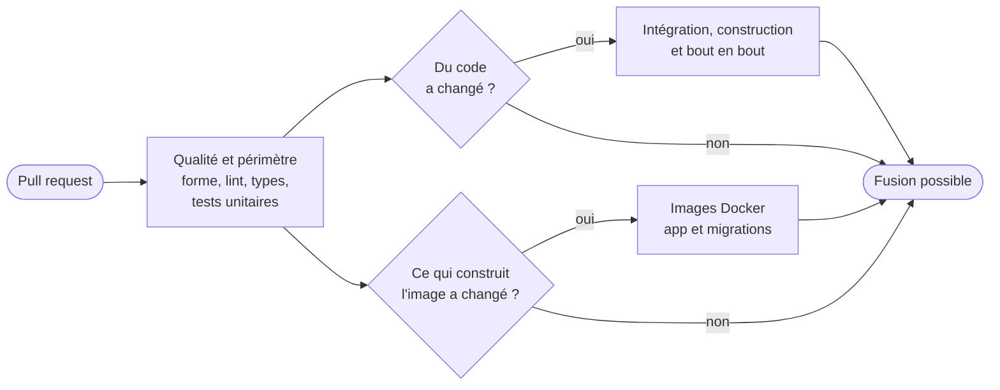

# Intégration continue, tests et mise en production

> **In English** — How every change to praxoraXwebbuilder is checked before it reaches
> production: formatting, lint and type checks, unit tests, integration tests against a real
> PostgreSQL (including tenant-isolation tests), a production build, end-to-end browser tests on
> demo sites, and the Docker images when what builds them changes — on every pull request, with
> documentation-only changes skipping the heavy jobs. The main branch is protected: GitHub refuses
> any merge until the checks pass. After the free CI minutes ran out in November 2026, I measured
> each job and cut usage by about 60 % without removing a check from code pull requests.
> Dependencies are updated weekly by Dependabot, major versions only through dedicated tickets.
> Deployment is deliberately a single manual step after merge.

_État au 12 novembre 2026. Exemple : praxoraXwebbuilder ; les autres projets suivent le même
modèle._

## La règle

**Rien n'arrive sur `main` sans être passé par une pull request vérifiée.** La vérification est
automatique (GitHub Actions) ; la décision de fusionner est humaine : c'est moi qui fusionne, après
relecture.

Depuis novembre 2026, la règle n'est plus seulement une discipline : la branche `main` est
protégée, et GitHub refuse la fusion tant que les vérifications ne sont pas vertes. La règle vaut
pour moi aussi, sans exception.

## Les étapes de la CI

| Étape                           | Ce qu'elle vérifie                                                                                                                                                    |
| ------------------------------- | --------------------------------------------------------------------------------------------------------------------------------------------------------------------- |
| **Qualité et périmètre**        | mise en forme (Prettier), lint (ESLint), types (TypeScript strict), tests unitaires (Vitest) ; et ce que touche la PR, qui décide des étapes suivantes                |
| **Intégration et bout en bout** | une vraie base PostgreSQL et un stockage S3 lancés dans la CI ; migrations ; tests d'intégration ; construction de production ; tests dans un navigateur (Playwright) |
| **Images Docker**               | les deux images de production se construisent (l'application, les migrations), quand la PR touche ce qui les fabrique : Dockerfile, dépendances, configurations       |

Quelques choix qui comptent :

- **Valeurs jetables** : les mots de passe de la base et du stockage de la CI sont générés pour
  chaque exécution ; aucun secret réel n'est nécessaire pour tester.
- **Temps limités** : chaque étape a un délai maximal ; un téléchargement bloqué échoue vite au
  lieu de faire attendre.
- **Cache du navigateur de test** par version de Playwright, et pas d'installation de paquets
  système inutiles : quelques minutes gagnées à chaque PR.
- **Rapport Playwright** gardé une semaine quand un test de bout en bout échoue, pour voir ce que
  le navigateur a vu.

## Une CI plus sobre

Le 11 novembre 2026 au soir, les dernières tâches de la CI n'ont pas démarré : le quota gratuit de
GitHub Actions (2 000 minutes par mois pour un dépôt privé) était épuisé, en onze jours. Aucune
PR n'est passée sans vérification, mais le signal était clair.

J'ai d'abord mesuré, tâche par tâche, avant de changer quoi que ce soit. Trois constats :

- **Près de la moitié des minutes jouait tout en double.** Après chaque fusion, toute la suite
  repartait sur `main`, pour un code déjà vérifié dans sa PR, documentation comprise.
- **L'image Docker était reconstruite à chaque PR**, alors qu'elle ne casse que si ce qui la
  fabrique change ; le code de l'application est déjà construit par l'étape de bout en bout.
- **Une étape de dix secondes coûtait une minute** : GitHub arrondit chaque tâche à la minute
  supérieure.

Ce qui a changé : plus d'exécution sur `main` après une fusion (sauf quand les dépendances
changent, pour garder à jour les caches partagés avec les PR), l'image Docker seulement quand
c'est utile, le périmètre calculé dans l'étape de qualité, et un **filet de sécurité** : la suite
complète tourne chaque lundi matin, et je peux la lancer à la main avant une mise en production
sensible. Gain attendu : environ 60 % de minutes en moins, sans retirer une seule vérification à
une PR de code.

Le risque accepté est écrit avec la décision : deux PR vertes chacune de leur côté qui se
contrediraient une fois fusionnées. L'exécution du lundi le verrait. Je comparerai la
consommation de fin novembre à la mesure de départ pour vérifier le gain.

## Les tests

| Niveau           | Outil      | Ce qu'on y teste                                                                                                 |
| ---------------- | ---------- | ---------------------------------------------------------------------------------------------------------------- |
| **Unitaires**    | Vitest     | blocs (validation, rendu, migrations), thèmes (contraste), calculs (horaires, tournée), démos (contenus valides) |
| **Intégration**  | Vitest     | sur PostgreSQL : publication, médias, formulaires, et surtout le **cloisonnement** entre sites                   |
| **Bout en bout** | Playwright | des sites d'essai dans un vrai navigateur : pages, langues, blocs, parcours                                      |

Trois tests disent beaucoup de la façon de travailler :

- **Les démos sont des tests.** Chaque site de démonstration est vérifié avant même d'être chargé :
  chaque bloc et chaque fiche valides, tout traduit en anglais, chaque lien interne vers une page
  qui existe. Une démo cassée ne peut pas être fusionnée.
- **Le cloisonnement est testé, pas supposé.** Des tests vérifient qu'un site ne lit ni n'écrit
  les données d'un autre, et un **test de garde** échoue si une nouvelle table oublie la protection
  au niveau des lignes.
- **Les tests ne touchent jamais aux vraies données.** Ils utilisent une base dédiée, créée et
  migrée automatiquement ; la remise à zéro refuse toute base dont le nom n'est pas celui d'une base
  de test.

## Les dépendances

- **Dependabot** propose chaque lundi les mises à jour mineures et correctives, **regroupées**
  (une PR pour la production, une pour le développement), ainsi que celles des images Docker et des
  actions GitHub.
- Les **versions majeures** sont ignorées par Dependabot : chacune fait l'objet d'un ticket dédié,
  avec lecture des notes de version.
- Une PR de dépendances passe par la même CI et se relit comme les autres.
- Les scripts d'installation des paquets npm sont **bloqués par défaut** ; chaque autorisation est
  explicite.

## La mise en production

Volontairement **simple et manuelle**, à ce stade du projet :

1. la PR est fusionnée après une CI verte ;
2. sur le serveur, une commande récupère le code, reconstruit les images et redémarre ;
3. l'image de **migrations** met la base à jour avant que l'application ne serve des visiteurs ;
   au démarrage, l'application met aussi à jour les configurations de sites enregistrées
   ([voir](../projets/praxora-webbuilder/exemples/faire-evoluer-un-bloc.md)) ;
4. un contrôle de santé vérifie l'application, la base et le stockage.

**Pourquoi pas de déploiement automatique ?** Un seul serveur, pas encore de client en
production, et des mises en ligne choisies : une étape humaine coûte une minute et évite de
publier un vendredi soir ce qui a été fusionné par erreur. La question se reposera avec les
premiers clients.

## Le book aussi

Ce dépôt public a sa propre vérification à chaque PR : mise en forme, et **recherche de secrets**
dans tout l'historique (gitleaks), parce qu'un dépôt public ne pardonne pas.

## En étude, bientôt

- **Tests de l'administration et de l'export** : chaque nouvelle brique arrivera avec ses tests
  dans la même CI (parcours d'administration en bout en bout, export rechargé dans une base vide).
- **Déploiement** : la question d'une mise en production automatique se reposera avec les premiers
  clients.
- **praxora-compta** : la même CI quand le code commencera, après l'étude.
