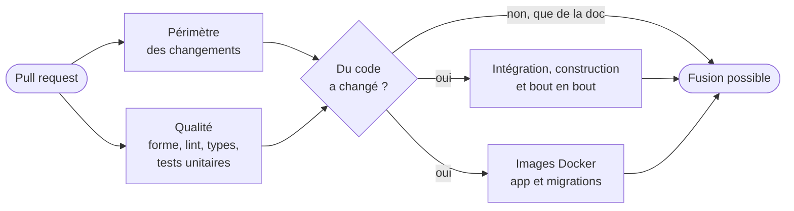

# Intégration continue, tests et mise en production

> **In English** — How every change to praxoraXwebbuilder is checked before it reaches
> production: formatting, lint and type checks, unit tests, integration tests against a real
> PostgreSQL (including tenant-isolation tests), a production build, end-to-end browser tests on
> demo sites, and both Docker images — all on every pull request, with documentation-only changes
> skipping the heavy jobs. Dependencies are updated weekly by Dependabot, major versions only
> through dedicated tickets. Deployment is deliberately a single manual step after merge.

_État au 31 octobre 2026. Exemple : praxoraXwebbuilder ; les autres projets suivent le même
modèle._

## La règle

**Rien n'arrive sur `main` sans être passé par une pull request vérifiée.** La vérification est
automatique (GitHub Actions) ; la décision de fusionner est humaine : c'est moi qui fusionne, après
relecture.

## Les quatre étapes de la CI

| Étape                           | Ce qu'elle vérifie                                                                                                                                                    |
| ------------------------------- | --------------------------------------------------------------------------------------------------------------------------------------------------------------------- |
| **Périmètre des changements**   | si la PR ne touche que de la documentation, les étapes lourdes sont sautées (une étape sautée ne bloque pas la fusion)                                                |
| **Qualité**                     | mise en forme (Prettier), lint (ESLint), types (TypeScript strict), tests unitaires (Vitest)                                                                          |
| **Intégration et bout en bout** | une vraie base PostgreSQL et un stockage S3 lancés dans la CI ; migrations ; tests d'intégration ; construction de production ; tests dans un navigateur (Playwright) |
| **Images Docker**               | les deux images de production se construisent : l'application et celle qui applique les migrations                                                                    |

Quelques choix qui comptent :

- **Valeurs jetables** : les mots de passe de la base et du stockage de la CI sont générés pour
  chaque exécution ; aucun secret réel n'est nécessaire pour tester.
- **Temps limités** : chaque étape a un délai maximal ; un téléchargement bloqué échoue vite au
  lieu de faire attendre.
- **Cache du navigateur de test** par version de Playwright, et pas d'installation de paquets
  système inutiles : quelques minutes gagnées à chaque PR.
- **Rapport Playwright** gardé une semaine quand un test de bout en bout échoue, pour voir ce que
  le navigateur a vu.

## Les tests

| Niveau           | Outil      | Ce qu'on y teste                                                                                                 |
| ---------------- | ---------- | ---------------------------------------------------------------------------------------------------------------- |
| **Unitaires**    | Vitest     | blocs (validation, rendu, migrations), thèmes (contraste), calculs (horaires, tournée), démos (contenus valides) |
| **Intégration**  | Vitest     | sur PostgreSQL : publication, médias, formulaires, et surtout le **cloisonnement** entre sites                   |
| **Bout en bout** | Playwright | des sites d'essai dans un vrai navigateur : pages, langues, blocs, parcours                                      |

Trois tests disent beaucoup de la façon de travailler :

- **Les démos sont des tests.** Chaque site de démonstration est vérifié avant même d'être chargé :
  chaque bloc et chaque fiche valides, tout traduit en anglais, chaque lien interne vers une page
  qui existe. Une démo cassée ne peut pas être fusionnée.
- **Le cloisonnement est testé, pas supposé.** Des tests vérifient qu'un site ne lit ni n'écrit
  les données d'un autre, et un **test de garde** échoue si une nouvelle table oublie la protection
  au niveau des lignes.
- **Les tests ne touchent jamais aux vraies données.** Ils utilisent une base dédiée, créée et
  migrée automatiquement ; la remise à zéro refuse toute base dont le nom n'est pas celui d'une base
  de test.

## Les dépendances

- **Dependabot** propose chaque lundi les mises à jour mineures et correctives, **regroupées**
  (une PR pour la production, une pour le développement), ainsi que celles des images Docker et des
  actions GitHub.
- Les **versions majeures** sont ignorées par Dependabot : chacune fait l'objet d'un ticket dédié,
  avec lecture des notes de version.
- Une PR de dépendances passe par la même CI et se relit comme les autres.
- Les scripts d'installation des paquets npm sont **bloqués par défaut** ; chaque autorisation est
  explicite.

## La mise en production

Volontairement **simple et manuelle**, à ce stade du projet :

1. la PR est fusionnée après une CI verte ;
2. sur le serveur, une commande récupère le code, reconstruit les images et redémarre ;
3. l'image de **migrations** met la base à jour avant que l'application ne serve des visiteurs ;
   au démarrage, l'application met aussi à jour les configurations de sites enregistrées
   ([voir](../projets/praxora-webbuilder/exemples/faire-evoluer-un-bloc.md)) ;
4. un contrôle de santé vérifie l'application, la base et le stockage.

**Pourquoi pas de déploiement automatique ?** Un seul serveur, pas encore de client en
production, et des mises en ligne choisies : une étape humaine coûte une minute et évite de
publier un vendredi soir ce qui a été fusionné par erreur. La question se reposera avec les
premiers clients.

## Le book aussi

Ce dépôt public a sa propre vérification à chaque PR : mise en forme, et **recherche de secrets**
dans tout l'historique (gitleaks), parce qu'un dépôt public ne pardonne pas.
