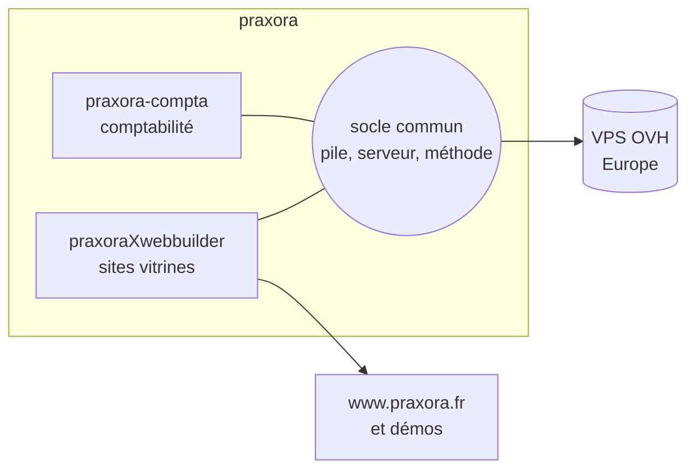

# praxora

> **In English** — praxora is my small company (registration planned for early 2027). It builds
> digital tools that belong to their users: open-source building blocks, European hosting, a full
> export of each client's data, and an interface that people actually enjoy using.

## L'idée

**praxora** crée des outils numériques qui **appartiennent à leurs utilisateurs**, sur une base
technique sérieuse, avec une interface qui donne envie de s'en servir. L'entreprise est en
création : immatriculation prévue début 2027.

Elle s'adresse d'abord à ceux que les grandes plateformes servent mal : indépendants, artisans,
petits commerces, associations.

## Les principes communs à tous les projets

| Principe                        | Ce que ça veut dire concrètement                                                                                                         |
| ------------------------------- | ---------------------------------------------------------------------------------------------------------------------------------------- |
| **Réversibilité**               | Le client peut partir avec un export complet (application, données, médias, guide) et le faire tourner ailleurs.                         |
| **Pas de service propriétaire** | Briques open source, auto-hébergeables ; hébergement en Europe (OVH).                                                                    |
| **IA optionnelle**              | Les aides IA sont un plus, débranchables ; tout reste faisable à la main.                                                                |
| **Cloisonnement**               | Chaque donnée est rattachée à son client, et la séparation est garantie par la base de données elle-même, pas seulement par l'interface. |
| **L'utilisateur d'abord**       | À valeur technique égale, l'expérience de l'utilisateur final tranche.                                                                   |

## Les projets

| Projet                                               | Rôle                                                        | État (31 octobre 2026)                                      |
| ---------------------------------------------------- | ----------------------------------------------------------- | ----------------------------------------------------------- |
| [praxoraXwebbuilder](../projets/praxora-webbuilder/) | sites vitrines des clients et site de praxora               | démos et site praxora en ligne ; version 1 visée début 2027 |
| [praxora-compta](../projets/praxora-compta/)         | comptabilité et facture électronique des auto-entrepreneurs | étude                                                       |

Les projets partagent la même pile technique, le même serveur et la même méthode ; chacun a son
dépôt, ses décisions et son journal. Le code commun (authentification, cloisonnement, thèmes) ne
sera extrait en paquet partagé que lorsque deux projets en auront besoin en même temps.

## Services

Au-delà des outils, praxora propose du développement de sites et d'applications, du conseil et
de l'accompagnement (technique, IA), et de la formation pour entreprises, associations et
particuliers. Le détail est sur [www.praxora.fr](https://www.praxora.fr).
