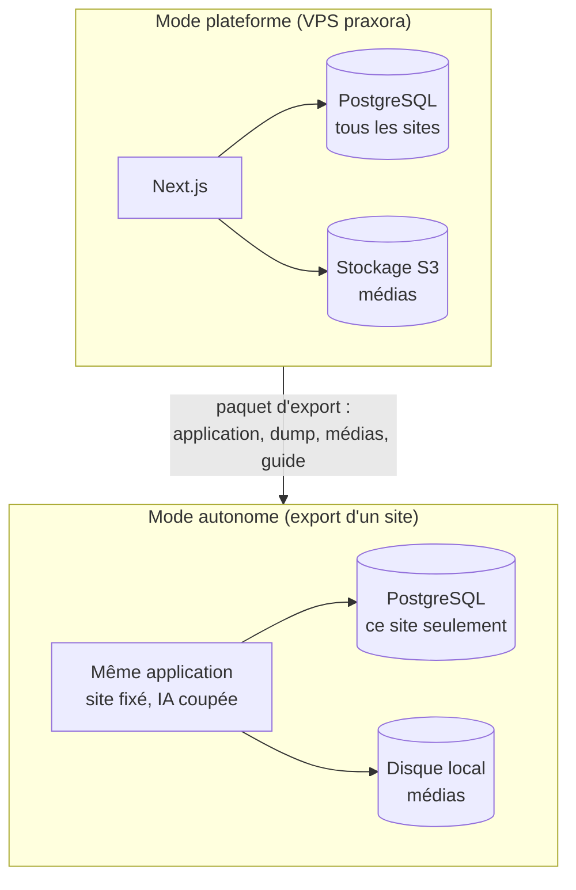

# Conception

> **In English** — The ideas behind the platform: one codebase with two modes (platform and
> standalone export); sites as structure + theme, applied by copy; a typed block catalogue from
> which validation, admin forms and permissions are derived; shared records referenced by blocks;
> versioned blocks migrated at startup; drafts and immutable published versions; tenant isolation
> enforced by PostgreSQL row-level security; images processed once at upload.

_État au 31 octobre 2026. Chaque idée renvoie à une décision écrite du projet (D-xxx)._

## 1. Un seul code, deux modes

Le même code tourne en **mode plateforme** (tous les sites, tous les clients) et en **mode
autonome** : un seul site, sans module IA, livré au client qui part. L'export n'est donc pas une
version à part qu'on oublierait de maintenir : chaque fonctionnalité dit si elle existe en
autonome. _(D-001, D-004)_

## 2. Un site = une structure + un thème

La configuration d'un site a deux parties **indépendantes** :

- la **structure** (template) : pages, zones globales (en-tête, pied de page…), blocs, variantes,
  ordre ;
- le **thème** : couleurs, polices, formes, fonds.

N'importe quel thème s'applique à n'importe quel template. Un site créé depuis un modèle en reçoit
une **copie** : retoucher un modèle ne change jamais en silence le site en ligne d'un client.
_(D-011, D-012)_

Les blocs ne connaissent que des **rôles de style** (« accent », « titres », « arrondi »), jamais
une valeur fixe ; le thème les remplit en variables CSS, et un test vérifie le **contraste** de
chaque modèle de thème. Les polices sont hébergées par la plateforme, sans service tiers. _(D-015)_

## 3. Des blocs à variantes, pas de placement libre

On différencie les sites par le **choix des blocs**, leur **variante** (mises en page prédéfinies,
conçues d'abord pour le mobile) et leur ordre. Pas de positionnement au pixel : c'est ce qui garantit
la qualité et l'affichage sur téléphone, et c'est ce que je vends. _(D-013, D-017)_

## 4. Le catalogue de blocs, source unique

Chaque type de bloc est **déclaré une seule fois** dans le code : ses champs (validés), chacun
marqué **réglage** (pour moi) ou **contenu** (pour le client), ses variantes, ses contenus
d'exemple, son numéro de version et ses migrations. De cette déclaration se déduisent :

- la **validation** des configurations enregistrées ;
- les **formulaires** de l'administration ;
- les **droits** du client, champ par champ ;
- l'**enregistrement comme modèle** (les contenus du client sont remplacés par les exemples :
  rien ne fuit d'un client vers un modèle).

_(D-014, D-027)_ — [voir un exemple de déclaration](exemples/declarer-un-bloc.md)

## 5. Des fiches saisies une fois

Ce qu'un site réutilise à plusieurs endroits (un professeur, une adresse, un chantier) est une
**fiche**, saisie une fois et choisie ensuite dans une liste. Le client ne retape jamais un nom ;
une fiche modifiée l'est partout. Les types de fiche suivent les mêmes règles que les blocs
(champs, versions, migrations) et restent **génériques** : on n'ajoute pas un type par métier.
_(D-041)_

## 6. Faire évoluer sans casser

Quand un type de bloc change de forme, il prend une **nouvelle version** et une **migration**
(fonction pure, testée). Les configurations enregistrées sont mises à jour **au démarrage, avant
d'accepter des visiteurs**, et toute configuration lue l'est aussi en mémoire : aucun visiteur ne
voit une page à laquelle il manque un bloc. Ajouter un champ facultatif ou un réglage avec valeur
par défaut ne demande pas de nouvelle version. _(D-036)_

## 7. Brouillon, publication, retour arrière

Un brouillon par site ; **publier** recopie le brouillon en une version numérotée, **jamais
modifiée ensuite** ; un retour arrière recopie une ancienne version en une nouvelle. L'historique
reste complet et linéaire ; les modifications simultanées sont détectées par un numéro de
révision. _(D-032)_

## 8. Le cloisonnement garanti par la base

Chaque donnée porte l'identifiant de son site. Le code n'accède aux tables d'un site qu'à travers
une transaction qui fixe ce site, et **PostgreSQL applique lui-même la séparation** (sécurité au
niveau des lignes, activée et forcée sur chaque table). L'application se connecte avec un rôle
soumis à ces règles ; seules les migrations utilisent le propriétaire des tables. Des tests
d'isolement tournent dans l'intégration continue.

Conséquence : **une erreur dans le code ne suffit plus** à montrer les données d'un client à un
autre. _(D-005, D-033)_

## 9. Des images prêtes une fois pour toutes

À l'envoi, chaque photo est redressée, **nettoyée de ses métadonnées** (position GPS comprise),
convertie et déclinée en cinq largeurs, en AVIF et WebP. Le fichier envoyé n'est pas conservé. Le
recadrage se fait par un **point focal** à l'affichage, sans fichier recadré. Le traitement tourne
en arrière-plan dans l'application elle-même, sans service supplémentaire. _(D-030, D-035)_

## 10. Ce que le client n'a pas à savoir

- **Deux langues** dès la V1 : une adresse par langue, balises `hreflang`, sélecteur « FR / EN »
  plutôt que des drapeaux (une langue n'est pas un pays). _(D-018)_
- **Données structurées** (schema.org) produites à partir des contenus : horaires, adresse, carte
  du restaurant. Le client n'en écrit jamais. _(D-048)_
- **HTTPS automatique**, y compris quand un client branche son propre domaine : le certificat est
  délivré au premier passage, après vérification que le domaine est bien connu de la plateforme.
  _(D-043)_
- **Cartes sans traceur** : carte statique par défaut, carte interactive (fond OpenStreetMap)
  chargée seulement si le visiteur le demande. _(D-052, D-061)_
